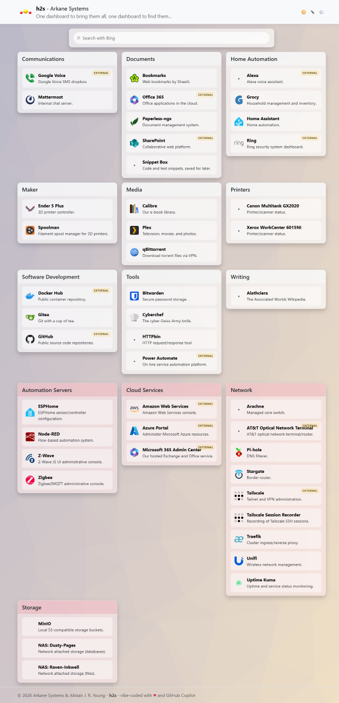
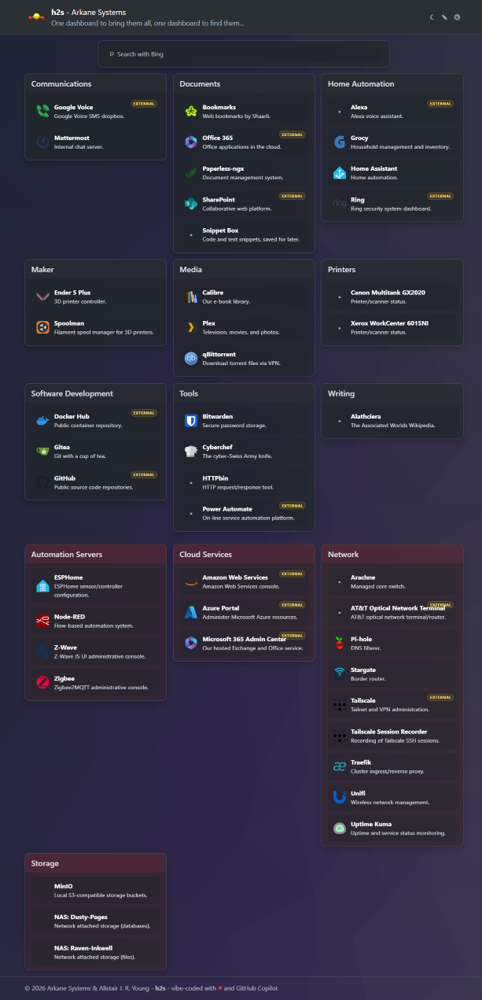

# h2s

h2s is a simple intranet dashboard app, which exists primarily because I got very tired of never finding one that precisely met my specifications. As such, it's rather tightly wrapped around my personal preferences, but it's open source and available for anyone to use or modify as they see fit. And I'm happy to accept contributions if you have ideas for improvements or new features.

It's built with ASP.NET Core Razor Pages and uses Bootstrap for styling, and stores its data in SQLite using Entity Framework Core. (Being configurable in itself and not requiring mucking around with YAML, etc., was a key requirement for me.)

The app is designed to be run in a Linux container (I do so using my Kubernetes cluster), but there's no reason it couldn't be run on Windows or macOS as well, either containerized or directly. I just haven't built deployments for those scenarios.

| Light Mode | Dark Mode |
| ------- | ------- |
|  |  |


## Build the container

From the repository root:

```bash
docker build -t h2s:local -f h2s/Dockerfile .
```

If you just want to run the current official build, however, it's available on GitHub Container Registry at `ghcr.io/arkane-systems/h2s:latest` (or with the specific version tag).


## Container publishing

A GitHub Actions workflow (`.github/workflows/publish-container.yml`) publishes images to GitHub Container Registry when a tag is pushed (if the tag commit is on `master`) or when manually dispatched (using the latest tag).

## Run the container (in Docker)

Create a local folder for persistent data, then run:

```bash
docker run --rm -p 8080:8080 --user "$(id -u):$(id -g)" -v "$(pwd)/data:/app/data" h2s:local
```

The app keeps its SQLite database (`h2s.db`) and its Data Protection keys (`keys/`) in `/app/data` inside the container. The image runs as the non-root `app` user (UID 1654) by default; any UID works as long as it can write to `/app/data`, which is why the example runs as your own user.

The app serves `/healthz`, which returns `Healthy` when the database is reachable.


## Running on Kubernetes

Here's a sample Kubernetes manifest for running h2s in a cluster. This creates a Namespace, Deployment, Service, and Ingress for the app.

```yaml
---
apiVersion: v1
kind: Namespace
metadata:
  name: h2s
---
apiVersion: apps/v1
kind: Deployment
metadata:
  name: h2s
  namespace: h2s
  labels:
    app: h2s
spec:
  replicas: 1
  strategy:
    type: Recreate
  selector:
    matchLabels:
      app: h2s
  template:
    metadata:
      labels:
        app: h2s
    spec:
      securityContext:
        runAsUser: <your-uid>
        runAsGroup: <your-gid>
      volumes:
        - name: h2s-config
          nfs:
            server: <your-nfs-server>
            path: "/path/on/your/nfs/server"
      containers:
        - image: ghcr.io/arkane-systems/h2s:latest
          name: h2s
          ports:
            - name: http
              containerPort: 8080
          livenessProbe:
            httpGet:
              path: /healthz
              port: http
          readinessProbe:
            httpGet:
              path: /healthz
              port: http
          volumeMounts:
            - mountPath: "/app/data"
              name: "h2s-config"
---
apiVersion: v1
kind: Service
metadata:
  name: h2s
  namespace: h2s
spec:
  selector:
    app: h2s
  ports:
    - protocol: TCP
      port: 8080
      name: http
  ipFamilyPolicy: PreferDualStack
---
apiVersion: networking.k8s.io/v1
kind: Ingress
metadata:
  name: h2s-ingress
  namespace: h2s
  annotations:
    traefik.ingress.kubernetes.io/router.entrypoints: 'websecure'
    traefik.ingress.kubernetes.io/router.tls: 'true'
spec:
  rules:
    - host: <your-hostname>
      http:
        paths:
          - pathType: Prefix
            path: /
            backend:
              service:
                name: h2s
                port:
                  number: 8080
```

*Notes:*

- The *Deployment* uses a Recreate strategy since the app doesn't support multiple instances running concurrently against the same database.
- The image runs as a non-root user (UID 1654) by default. The *Deployment*'s *securityContext* overrides that UID to match the permissions of the mounted volume, which is owned by that user on my NFS server. If you use a different storage solution, you may need to adjust the UID/GID accordingly (or drop them to use the default), and will definitely need to adjust the volume definition.
- The liveness and readiness probes use `/healthz`, which checks that the database is reachable.
- My cluster and network is dual-stacked IPv4/IPv6, hence the *ipFamilyPolicy* setting in the *Service* definition. You will need to remove or change this if yours is not.
- The *Ingress* is configured for Traefik with TLS enabled, but you can adjust the annotations and TLS settings as needed for your ingress controller and environment. It also (as does h2s itself) assumes that HTTPS will be handled entirely by the ingress controller and the app itself need only concern itself with HTTP. h2s honors the `X-Forwarded-For` and `X-Forwarded-Proto` headers from any proxy, so it sees the original client address and scheme; don't expose it directly to untrusted networks.

#### Trusting a homelab certificate authority

When you add a link, h2s fetches the page from the server, following redirects from the base URL, to suggest a label and an icon from its title and the app name it declares. Later versions use the same kind of fetch for favicons and the Uptime Kuma monitor list. These requests validate certificates normally, so internal sites whose certificates come from your own CA quietly produce no suggestions until the container trusts that CA. Nothing else is affected.

To trust it, mount the CA certificate (PEM format) into the container, and add its directory to `SSL_CERT_DIR`, keeping the system directory so public sites still work. For example, with the CA in a ConfigMap named `homelab-ca`:

```yaml
      volumes:
        - name: homelab-ca
          configMap:
            name: homelab-ca          # contains homelab-ca.crt
      containers:
        - name: h2s
          env:
            - name: SSL_CERT_DIR
              value: /etc/ssl/certs:/app/ca
          volumeMounts:
            - mountPath: /app/ca
              name: homelab-ca
              readOnly: true
```

This needs no root access and no rebuilt image.


## Using the dashboard

When you open the app, the home page shows link categories and their links. You can:

- Browse categories and open links directly from each card. Click a category's name to collapse it to its header (showing how many links it holds), and again to open it; your browser remembers which are collapsed. Edit mode always shows every category open.
- Use the search box for quick web searches. It uses the default engine from **Settings → Search**. To use another for one search, click the ⌕ and pick it (the menu also shows each engine's shortcut), or start or end the search with the engine's shortcut, such as `!g`. A shortcut wins if you do both.

### Keyboard and accessibility

Everything works from the keyboard. **Tab** first reaches a **Skip to main content** link. Tiles, category titles and the search box's engine menu take focus with a clear ring, dialogs return focus to whatever opened them, and edit mode's tiles open with **Enter** or **Space**. Drag handles also move with the arrow keys, and each move is announced. Screen readers get a heading for the dashboard and each category, and toasts are announced. With **reduce motion** turned on in the operating system, transitions and drag animations are switched off.

### Installing as an app

h2s can be installed as an app, to use as a start page in its own window: in Edge or Chrome, use **Install** in the address bar (or the browser menu's **Apps** / **Cast, save and share** entry); on a phone, **Add to Home screen**. The app is named after the dashboard's title in **Settings → General**. It needs the network to do anything useful, so there's no offline mode.

### Quick launch

Start typing anywhere on the dashboard (or press `/`) to open **quick launch**, a search box that floats over the page and narrows the dashboard to the links whose name, description or address match:

- **Enter** opens the highlighted link, and **Ctrl+Enter** (⌘+Enter on a Mac) opens it in a new tab. **↑** and **↓** move between matches.
- **Shift+Enter** searches the web instead, with the default engine.
- When no links match, quick launch lists the search engines in their Settings order. Enter searches with the highlighted one (the default, until you pick another with ↑ and ↓). A `!shortcut`, such as `!g`, picks the engine straight away.
- **Esc**, or a click outside the box, closes it and puts the dashboard back.

Quick launch is off in edit mode, and while you're typing in a field such as the search box. It shows matches in collapsed categories too, opening them until you close it.

The search box and status bars are **panels**: full-width cards above or below the categories. Edit mode rearranges them. A panel with nothing to show, such as a status bar with no items yet, is hidden outside edit mode.

A **status bar** is a row of status widgets, such as Uptime Kuma monitors (group monitors make good ones), each under its own label. A dashboard can have several, say one for the infrastructure and one for the home, each with an optional **title** at its start and an optional **link** the bar opens when clicked, such as a Kuma status page.
- Pick a color mode for your browser with the navbar's ◑ button. It cycles through the site default, Light, Dark and Auto, and only your browser changes; back at the site default, it follows **Settings → Appearance** again.

### Settings page

Open **Settings** (⚙) from the navbar. It's a page of cards, each saved on its own with its **Save** button; the links at the top jump to each.

- **General**: the **title** and **motto** shown in the navbar, and the **local domains**. Type each domain and press Enter, comma or space to add it as a chip; × removes one. Links to hosts outside these domains get an "External" badge.
- **Appearance**: the site's **color mode**, which every browser uses until it picks its own with the navbar's ◑ button. Auto follows the device's light or dark setting.
- **Search**: the search engines, below.
- **Integrations**: one card per integration, each with a **Save**, **Test connection** and **Remove**: Uptime Kuma and the JSON API, below.
- **Backup**: export and import the whole configuration, below.

#### Search engines

The search box sends searches to the **default** engine. h2s starts with Bing (the default, `!b`), DuckDuckGo (`!d`) and Google (`!g`). Start or end a search with an engine's shortcut to send it there instead; a shortcut no engine has stays in the search, so DuckDuckGo's own bangs still work when it's the default.

Click **+ Add engine**, or an engine's name to edit it. Its **search URL** is the address of a results page with `{query}` where the search terms go: search for something on the engine, copy the address, and replace your terms with `{query}`. Ticking **Default engine** moves the default to that engine. Drag the ⠿ handles (or focus one and use the arrow keys) to reorder the list; the search box's ⌕ menu and quick launch list the engines in the same order. Deleting an engine has **Undo**; deleting the default makes the first engine left the default. With no engines, the search box is hidden.

#### Uptime Kuma integration

You can optionally connect Uptime Kuma, for monitor widgets on links' tiles (see the link dialog's **Widgets**) and status bars:

- **Server URL**: the base URL of your Kuma instance (for example `https://status.example.com`).
- **API key**: a key created in Uptime Kuma under **Settings → API Keys** (Kuma 1.21 or later). h2s uses it only to read Kuma's `/metrics`, which lists every monitor; it's stored encrypted and never shown again.
- **Default uptime period**: 1 day, 30 days or 365 days, the windows Kuma reports; each widget can choose its own.

**Save** turns the integration on. **Remove** turns it off again, after asking, and forgets its settings.

**Test connection** checks the values in the form before you save them. It tells you whether the server answers, whether h2s trusts its certificate, whether Kuma accepts the API key and how many monitors and groups it reports, and, with a slug, whether the status page exists.

> Upgrading from an earlier version converts what Kuma used to draw as its own badge images into widgets, which read Kuma directly and need no published status page. Each link's Uptime Kuma monitor becomes a monitor widget on the link, unless it already had one for that monitor. Each infrastructure group becomes an item of the status bar, labelled with the group's name, and the status page the bar linked to becomes its link. Importing an older backup does the same.

#### JSON API integration

Connect any service that answers HTTP requests with JSON, for **Value** widgets on links' tiles and in status bars: a status, a count, a version, a response time, whatever the service reports. The card has:

- **Base URL**: where the service lives, with a path prefix if it has one (for example `https://host.example.com/api`). No query or fragment. Requests only ever go to this host, and redirects aren't followed (point the URL at where the service really answers).
- **Authentication**: **None**, **Basic** (a **username** and the credential as the password), **Bearer token** (the credential is the token) or **Custom header** (a **header name** such as `X-Api-Key`, with the credential as its value).
- **Credential**: the password, token or header value. It's stored encrypted, never shown again and never exported; leave it blank to keep the stored one. After importing a backup, enter it again.

**Test connection** requests the base URL with these settings: success when it answers, a clear failure when the credentials are refused (401 or 403), and a warning for any other status, since widgets read paths under the base and a 404 at the base itself may be fine. Certificate and network problems are told apart as for Uptime Kuma.

In the link dialog (or a status bar's items), **+ Add widget → JSON API: Value** takes:

- **Path**: what to request, relative to the base URL, with a query if it needs one (`/json`, `status?full=1`). A full address, or a path that climbs out of the base, is refused.
- **Value**: where the value is in the answer. Join keys with dots (`slideshow.title`), pick the nth item of a list with `[n]`, counting from 0 (`slideshow.slides[1].title`), and write a key with dots, spaces or brackets as `["odd key"]`. Leave out the key, or write `$`, for the whole answer.
- **Name** (optional): what the value is called in the tooltip, such as "Slides"; the value path if blank.
- **Unit** (optional): shown after the value, such as `ms`, `%` or `slides`.
- **Expected value** (optional): when set, the pill is green if the value is exactly this and red if it isn't. Without it, the pill is green whenever the value can be read.

The pill shows the value with its unit (`42 ms`, `93%`, `2 slides`). A string is shown as it is, cut to about 40 characters; a number as the service writes it; `true` or `false`; and a list as its number of items, so `slideshow.slides` with the unit `slides` reads `2 slides`. The tooltip says it in a sentence ("Slides is 2 slides."). An object or `null`, or a path the answer doesn't have, gives an amber pill; an error status, an answer that isn't JSON, or one over 256 KB gives a red one; a service h2s can't reach gives a grey one. The widget form's preview shows what it reads, so you can check a path before saving. Widgets on the same service and path share one request (kept for 15 seconds), and refresh every minute by default.

### Edit mode

Click **Edit** at the right of the navbar to edit the dashboard in place; **Done** returns to the normal view.

- Drag the ⠿ handles to reorder categories (within the regular or admin section), links (within or between categories) and panels (within or between the zones above and below the categories). A focused handle also responds to the arrow keys; a panel's carries on into the other zone past the end of its own. Each move saves straight away.
- Click a tile to edit or delete its link, or **+ Add link** under a category to add one. Start with the URL (paste it, or type it and move on): h2s follows it to the app's page, suggests a label from the page title or app name and a [selfh.st](https://selfh.st/icons/) icon to match, and shows a live preview of the tile.
  - **Browse…** searches the selfh.st icons with thumbnails.
  - When there's no selfh.st icon, the site's own icon (its favicon or app icon) is suggested as the **icon image URL**; you can also paste any image URL there. A tile uses the selfh.st icon first, then the image URL, then a plain dot.
  - **Widgets** add live figures to the tile from an integration you've set up, such as an Uptime Kuma monitor's status, response time and uptime, or any value from a JSON API. **+ Add widget** picks a kind and fills in its settings, such as a monitor picked by name from the ones Kuma reports (or **Another value…** to type an ID); the ↑ ↓ buttons order them, ✎ edits one and × removes it. The dialog's preview shows the widgets live as you edit them, and the widget being edited says what it reads, so you can check it before saving. They're saved with the link. Status widgets show as small coloured pills on the right of the tile (green up, red down, amber pending, blue maintenance, grey unknown), with the details as a tooltip, and refresh on their own (every minute by default).
  - **Open in a new tab** makes the tile open its link in a new browser tab. The list view marks such links with ↗.
- Use a category's ✎ to rename it, move it between the regular and admin sections, or delete it with its links, and **+ Add category** to add one.
- Use a panel's ✎ to change its options or delete it, and **+ Add panel** to add one above or below the categories. A status bar's dialog has its title, its link and its **Items**, edited like a link's widgets, each with a **label**, and a live preview of the bar; the search box's has its placeholder text. There can be only one search box, so **+ Add panel** offers it only when there isn't one.
- Deletes take effect immediately, and the toast that confirms them has an **Undo** button.

### List view

**List view** in the edit-mode banner opens every link in one table:

- Filter by text (label, URL, description or icon) and by category. Click a column heading to sort by it; **Widgets** counts each link's widgets.
- Click a row to edit the link in the same dialog as edit mode, or use **+ Add link**.
- Tick links (or the heading's box, for everything shown) to move them to another category, or to delete them. Deletes have **Undo**.

Categories are managed in edit mode.

### Backup

**Settings → Backup** exports the whole configuration as a JSON file: the settings, the categories with their links and widgets in order, the panels with their widgets (such as a status bar's items), the search engines and the integrations' connections (such as Uptime Kuma's and the JSON API's). Secrets, such as API tokens, are never exported: importing keeps the ones already set for the same connection, and elsewhere you enter them again. **Import…** takes such a file. h2s first checks it and shows what it holds, then replaces everything only when you confirm. Export first if you might want the current configuration back. The file is plain, indented JSON, so it also works for keeping a configuration in version control. Files exported before panels or search engines existed still import, and give the dashboard the defaults: the status bar, then search, above the categories, and the three engines above.

## Future plans (at this time)
- Authentication and permissions to access the editor and settings (currently these are open to anyone who can access the app, which is fine for my use case but not ideal for everyone).
- Add-on modules for individual links, displaying target-related dynamic content.
- Local icons for special cases.
- Grab message/quote from web function.

## Contributing

- If you feel confident in your ability to contribute code, please fork the repository and submit a pull request with your changes. I'm happy to review and merge contributions that align with the project's goals and coding standards.
- If you feel less confident, but still want to contribute, please open a discussion and we can figure out how your ideas fit into the project. I'm open to suggestions for new features, improvements, or any other feedback you may have.
- And, of course, feel free to report any bugs or issues you encounter while using the app.

